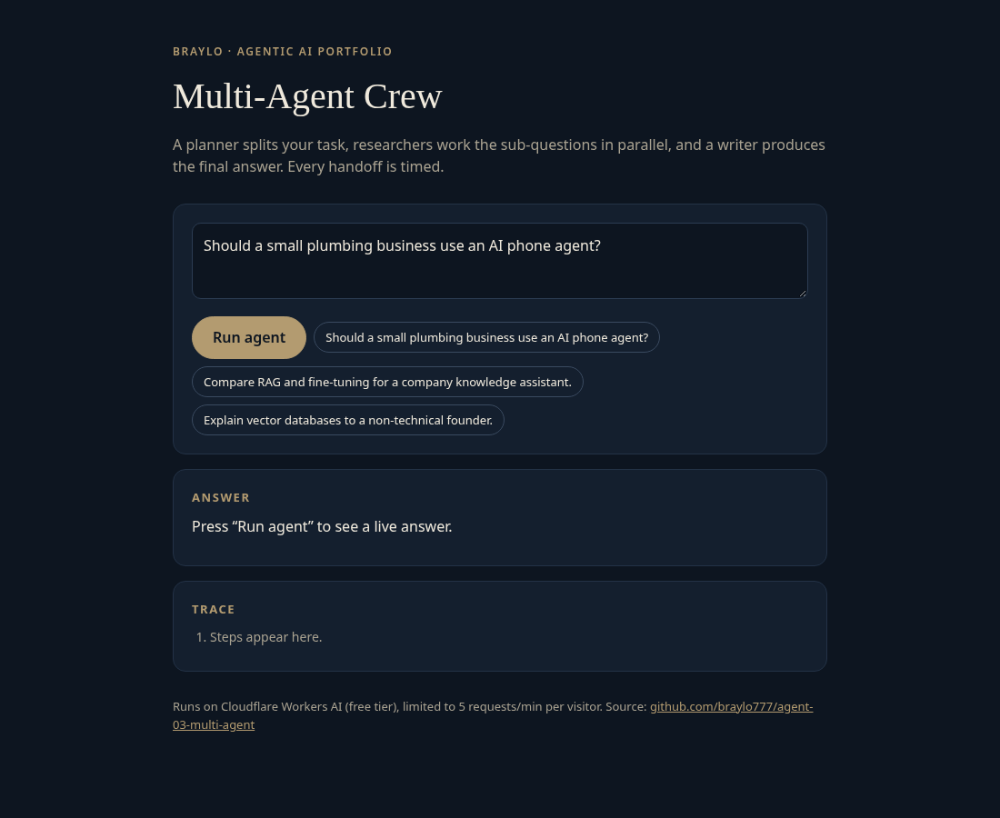
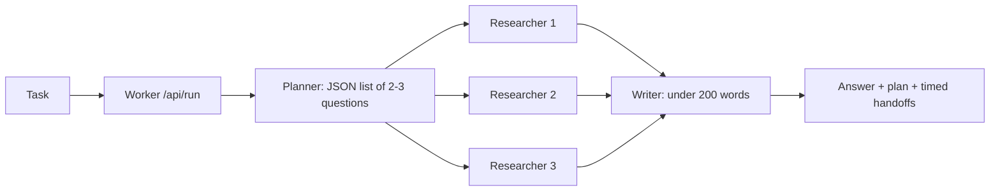

# Multi-Agent Crew

Three specialised agents (planner, researchers, writer) collaborate on a task. The planner splits it into sub-questions, researchers answer them in parallel, and the writer composes the final answer. Every handoff is logged with timing. Runs serverless on Cloudflare Workers with the free Workers AI tier. Project 3 of a 10-part agentic AI portfolio by Braylo.

**Live demo:** https://agent-03-multi-agent.braylo777.workers.dev



## Architecture


## How it works
1. **Planner** returns a JSON array of sub-questions; `parseJSON` extracts it even when wrapped in prose. Bad or empty plans fall back to the task itself; plans are capped at 3.
2. **Researchers** run concurrently with `Promise.all`, one per sub-question, each with its own instructions and token budget.
3. **Writer** sees only the task and the research notes and writes the final answer.
4. Each handoff (`user → planner → researcher#n → writer → user`) is logged with elapsed milliseconds, so per-stage latency shows in the demo.

- `src/crew.js`: agent instructions and orchestrator
- `src/core.js`: Workers AI, JSON parsing, rate-limit helpers
- `src/index.js`, `src/page.html`: routes and demo UI

Guardrails: 5 requests/min per IP (Workers Rate Limiting), 500-character input cap, errors returned as JSON.

## Evaluation (live model)
[`evals/run.mjs`](evals/run.mjs) sends every case in [`evals/cases.json`](evals/cases.json) to the **deployed** demo (Llama 3.3 70B fp8 on Workers AI) and scores it. A case passes when the response is HTTP 200, the answer contains the expected key fact(s) (case-insensitive), the planner returned 2-3 sub-questions, the handoff chain is complete, and the answer is at most 230 words. Latency is end-to-end HTTP from the eval machine. The suite is deliberately small to stay inside the free daily Workers AI allowance, so treat the numbers as indicative.

**12 cases** ([`evals/results.json`](evals/results.json), 2026-10-28T00:20Z (approx.)):

| Metric | Value |
|---|---|
| Pass rate (all checks) | 91.7% (11/12) |
| Answer contains expected key terms | 91.7% (11/12) |
| Planner produced 2-3 sub-questions | 100.0% (12/12) |
| Handoff chain complete (user → planner → researchers → writer) | 100.0% (12/12) |
| Final answer ≤ 230 words | 100.0% (12/12) |
| Latency p50 / p95 (end-to-end, 5 LLM calls per task) | 9382 ms / 25774 ms |

Only failure: `r01` ("Should a small plumbing business use an AI phone agent?…") gave pros and cons but never used the word "recommend", so the key-term check failed. Recovered from the eval console log of a full 12-case run (metrics block printed by evals/run.mjs). The per-case file was lost when the build machine was restored from a snapshot; the shared free Workers AI allowance was exhausted before a re-run. r12's per-case line was not captured; it is counted in the metrics block below.

## Tests
9 offline unit tests (`node --test`), 9 passing. The LLM and HTTP APIs are mocked, so they run without a Cloudflare account.

## Run it
```bash
npm install
npm test                    # unit tests, Node 20+
npx wrangler dev            # local dev; Workers AI uses your Cloudflare login
npx wrangler deploy         # free tier, no paid API keys
node evals/run.mjs          # live eval against the demo (paced for the rate limit)
```

## License
MIT
